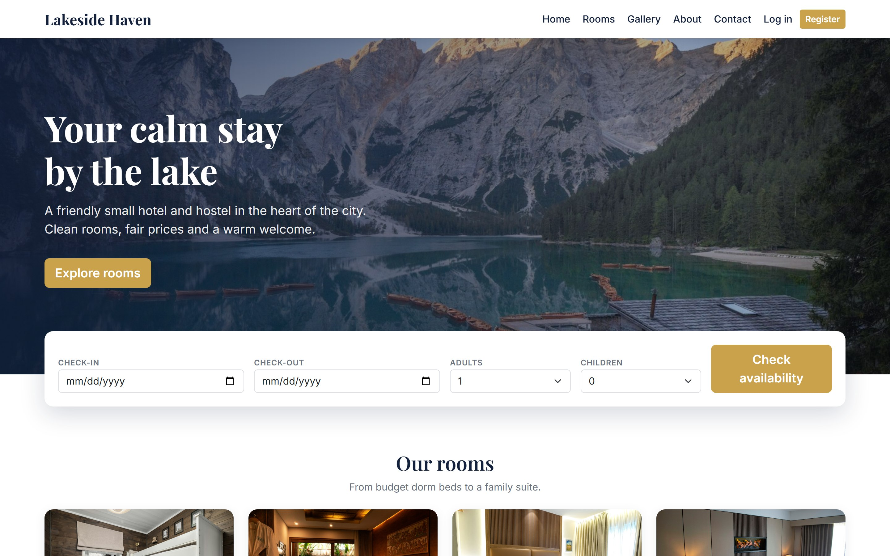
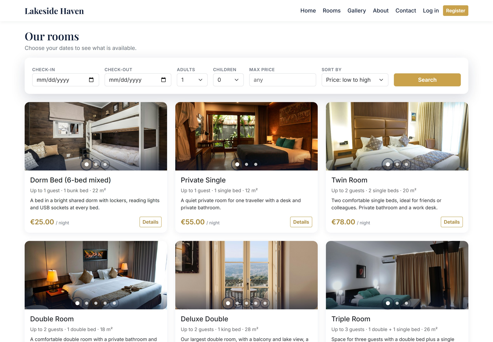
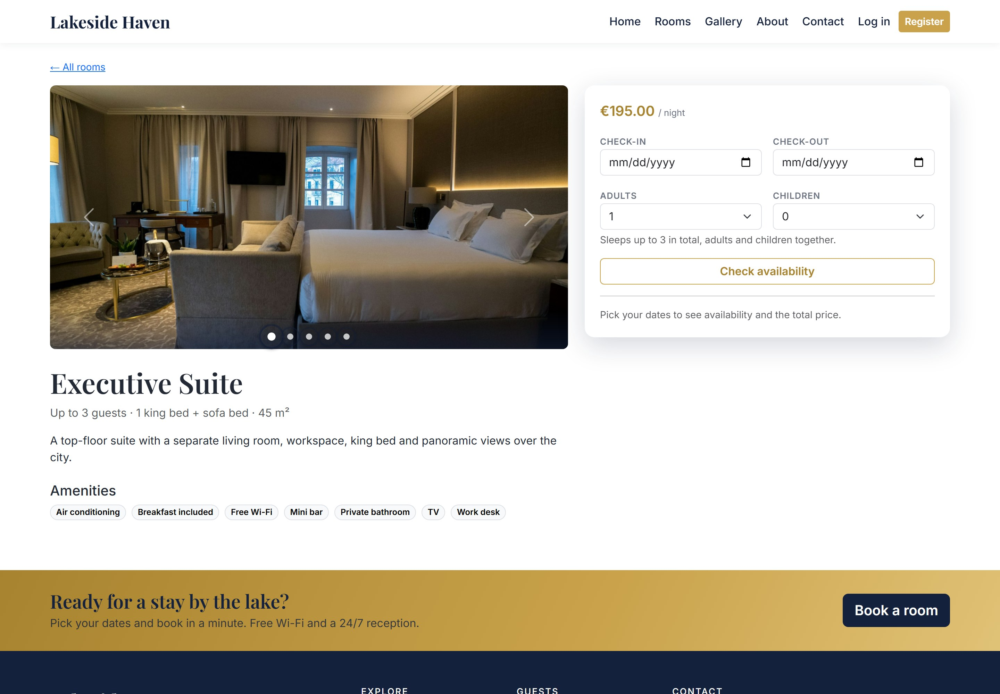
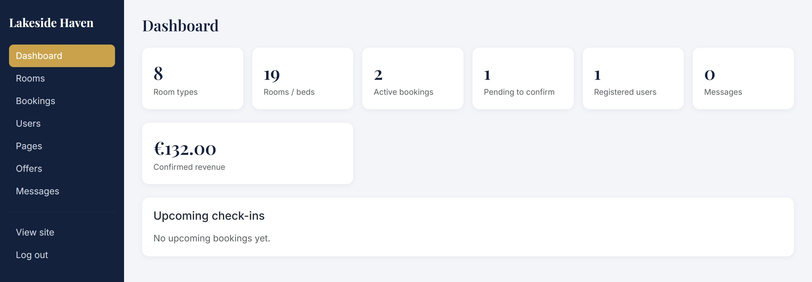
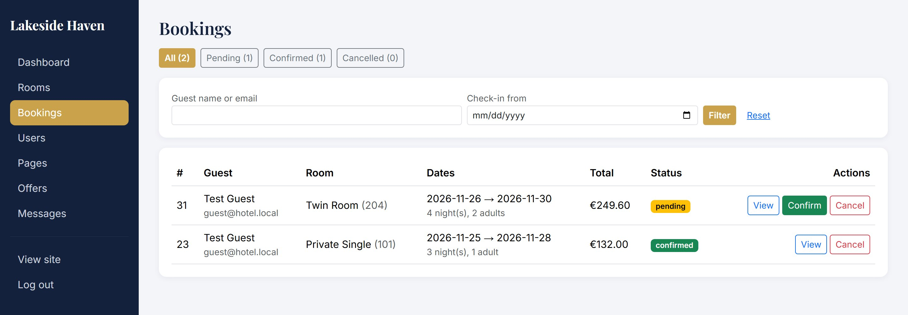
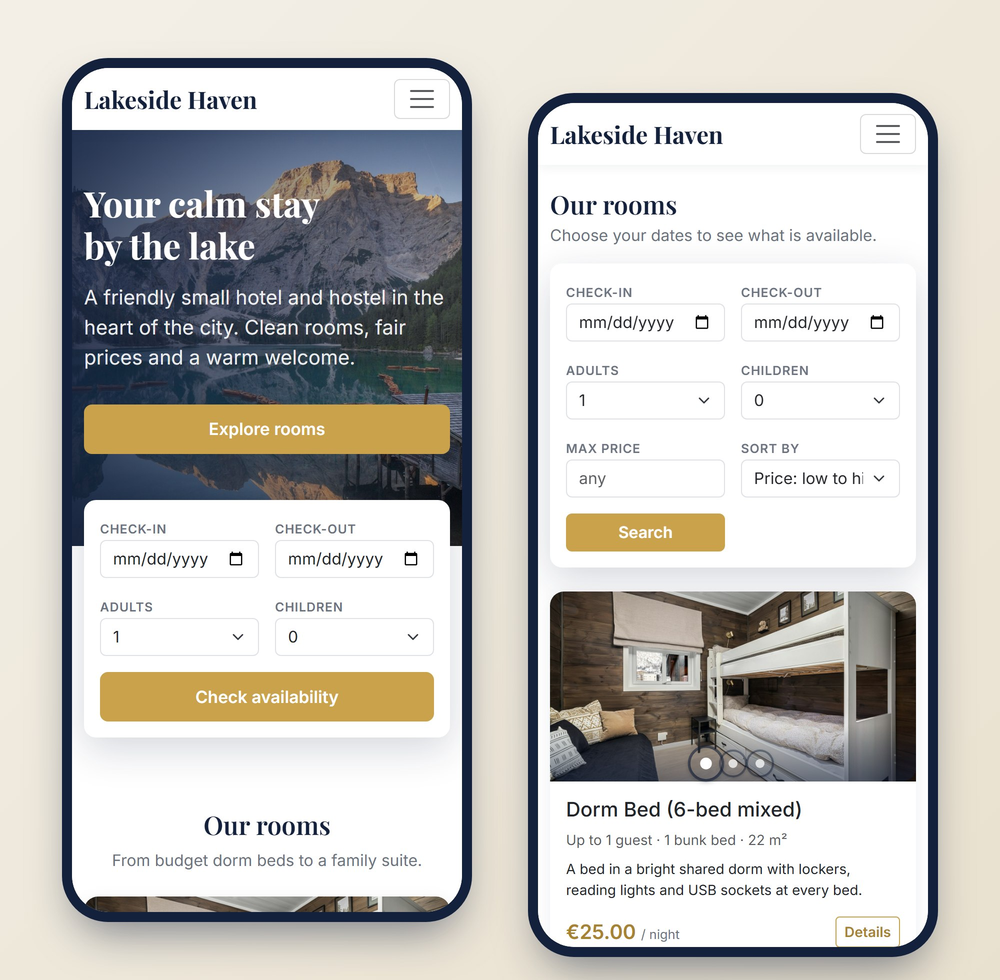

# Lakeside Haven: hotel / hostel website with CMS

A small hotel website built with plain PHP 8 and MySQL. Visitors can browse rooms,
registered users can book, and an admin manages everything in a CMS.

<p align="center">
  
</p>
<p align="center"><em>The home page: a lake view, and a date search that goes straight to live availability.</em></p>

## A quick look

<table>
  <tr>
    <td width="50%" align="center">
      <br>
      <b>Rooms</b><br>
      <sub>Filter by dates, guests and price. Every room has its own photo carousel.</sub>
    </td>
    <td width="50%" align="center">
      <br>
      <b>One room</b><br>
      <sub>Photos, amenities and an availability checker that shows the total price.</sub>
    </td>
  </tr>
</table>

### The admin CMS

<table>
  <tr>
    <td width="50%" align="center">
      <br>
      <b>Dashboard</b><br>
      <sub>Rooms, bookings, users and messages at a glance, plus confirmed revenue.</sub>
    </td>
    <td width="50%" align="center">
      <br>
      <b>Bookings</b><br>
      <sub>Filter by status, then confirm or cancel with one click.</sub>
    </td>
  </tr>
</table>

### On a phone

<p align="center">
  
</p>
<p align="center"><em>Made for phones too: the same pages from 320 px wide up to large desktop screens.</em></p>

## Features

**Public**
- Home page with date search, featured rooms and a live special offer
- Rooms list with filters (dates, adults and children, max price) and sorting; live availability and total price
- Room page with photo gallery, amenities and an availability checker
- Gallery, About (editable) and Contact (messages saved to the CMS)

**Registered users**
- Register, log in, log out, edit profile, change password
- Book a room (visitors who are not logged in can only look; "Book" sends them to login)
- "My bookings": upcoming and past bookings, cancel before check-in, printable confirmation

**Admin CMS (`/admin`)**
- Dashboard: counts, confirmed revenue, upcoming check-ins
- Room types: add, edit, delete, amenities, visibility
- Individual rooms: add, maintenance mode, remove
- Photos: multi-upload, cover photo, delete
- Bookings: filter, view, confirm, cancel
- Users list, Pages editor (Home / About), Offers (with date window), Contact messages

## Setup (XAMPP)

1. Get the code into `C:\xampp\htdocs\hotel`. The folder must be called `hotel`:
   ```
   cd C:\xampp\htdocs
   git clone https://github.com/ToniGift/Lakeside_Haven_Hotel.git hotel
   ```
   (or download the ZIP from GitHub, unzip it and rename the folder to `hotel`).
2. Start **Apache** and **MySQL** in the XAMPP Control Panel.
3. Import the database (phpMyAdmin, or the command line):
   ```
   C:\xampp\mysql\bin\mysql.exe -u root < database\schema.sql
   C:\xampp\mysql\bin\mysql.exe -u root < database\seed.sql
   ```
4. Open <http://localhost/hotel/>.

If you use a different folder name or port, change `BASE_URL` (and the database
settings if needed) in `config/config.php`.

## Test accounts (from `database/seed.sql`)

| Role  | Email             | Password    |
|-------|-------------------|-------------|
| Admin | admin@hotel.local | Admin123!   |
| User  | guest@hotel.local | User1234!   |

Change these before putting the site anywhere public.

## How booking works

- A room can never be booked twice for overlapping nights. A stay may start on the day
  another one ends (check-out day is free).
- Booking runs in a database transaction that locks the rooms of that type while it
  re-checks availability, so two people booking at the same moment cannot get the same room.
- Prices are calculated on the server, with the highest live offer applied.
- New bookings are "pending" until the admin confirms them. Payment is at the hotel.

## Connected to the Mini CRM

This site works with the companion **Mini CRM** project
(<https://github.com/ToniGift/mini-crm>). Every guest and booking is copied into the CRM as it happens, so the
hotel's customers and income can be followed there.

| Hotel | CRM |
|---|---|
| Guest registers | A customer is created (matched by email, never duplicated) |
| Guest books a room | A project named `Hotel booking #ID: Room, dates` |
| Admin confirms the booking | The project's income becomes the booking total |
| Booking is cancelled (guest or admin) | The project is marked `(cancelled)` and income returns to 0 |

**To turn it on**

1. Set up the CRM in `C:\xampp\htdocs\crm` (see its README). It uses the database `crm_db` on the same MySQL server.
2. Add the link column once:
   ```
   C:\xampp\mysql\bin\mysql.exe -u root < C:\xampp\htdocs\crm\database\upgrade_hotel_link.sql
   ```
3. Copy bookings that already exist (optional, safe to repeat):
   ```
   C:\xampp\php\php.exe C:\xampp\htdocs\hotel\database\sync_to_crm.php
   ```

The code is in `includes/crm_sync.php`. If the CRM is missing or down, the hotel keeps working and the problem is only
written to the error log. To switch the sync off, add `define('CRM_SYNC', false);` to `config/config.php`.

## Security notes

- Passwords hashed with `password_hash()`; sessions regenerated on login; cookie is HttpOnly + SameSite
- PDO prepared statements everywhere; all output escaped
- CSRF token on every form that changes data
- Role checks on every admin and user page
- Uploads: type and size checked, random file names, scripts blocked in the uploads folder
- `config/`, `includes/` and `database/` are blocked from direct web access (Apache `.htaccess`)

## Folder structure

```
config/     settings            includes/   shared code (db, auth, helpers, layout)
admin/      CMS pages           assets/     css, js, uploads
database/   schema + seed SQL   *.php       public pages
```

---

# Project plan

## Lakeside Haven, hotel / hostel website with CMS (finished)

**Goal:** the website of one small hotel/hostel with its own booking system and a CMS.
Visitors can only look; only registered users can book; an admin manages everything.

**Stack:** plain PHP 8, MySQL (PDO), Bootstrap 5, a little JavaScript. Runs on XAMPP.

**Roles**

| Role | Can do |
|---|---|
| Visitor | Browse home, rooms, gallery, about, contact. See prices and availability. Cannot book. |
| Registered user | Everything above, plus book a room, "My bookings", cancel before check-in, edit profile. |
| Admin | CMS: rooms, photos, bookings, users, page texts, offers, messages. |

**Phases**

| Phase | Work | Status |
|---|---|---|
| 1 | Database schema, seed data, config, layout | Done |
| 2 | Register, login, logout, roles | Done |
| 3 | Public pages: home, rooms, room detail, gallery, about, contact | Done |
| 4 | Admin CMS: dashboard, room types, rooms, photo upload | Done |
| 5 | Availability search and booking logic (transaction, no double booking) | Done |
| 6 | Admin bookings (confirm / cancel) and users list | Done |
| 7 | Admin editors for pages, offers and contact messages | Done |
| 8 | Hardening, profile page, 404 page, README | Done |
| 9 | Photos: lake hero, room photos, gallery lightbox, About photo | Done |
| 10 | Responsive layout from 320 px to 2560 px | Done |
| 11 | More room types (8 types, 19 rooms), three photos per room | Done |

**Core booking rule:** two stays overlap when `existing.check_in < new.check_out AND existing.check_out > new.check_in`.
A stay may start on the day another one ends.
